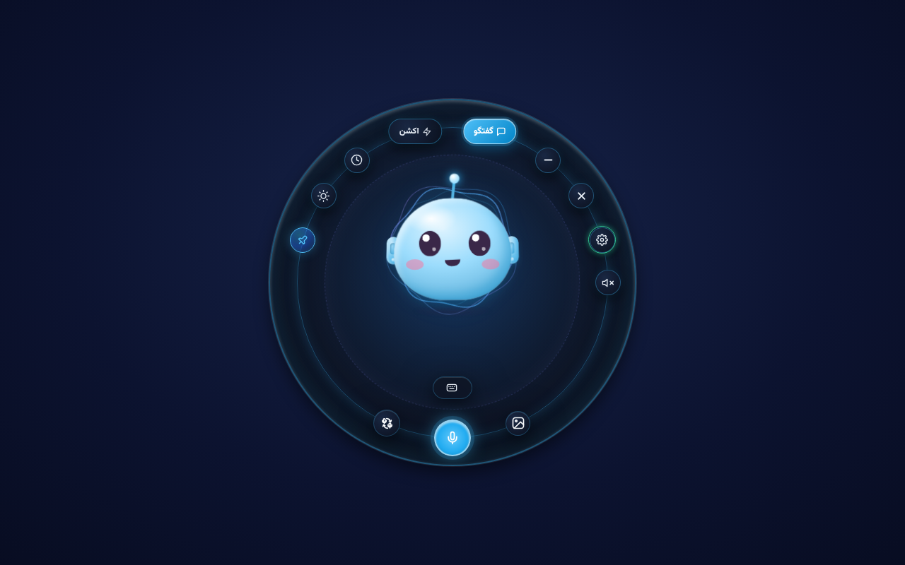
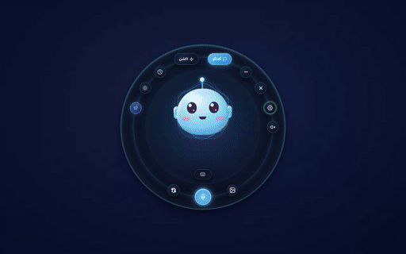
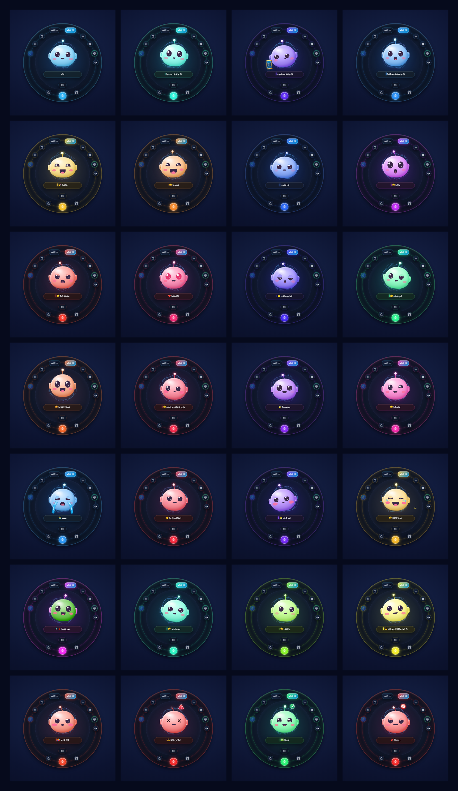
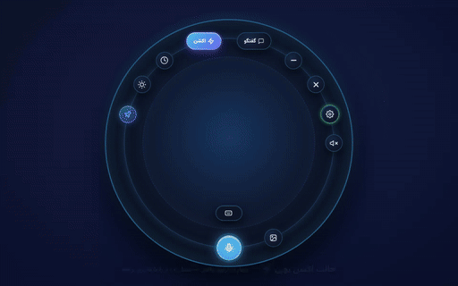
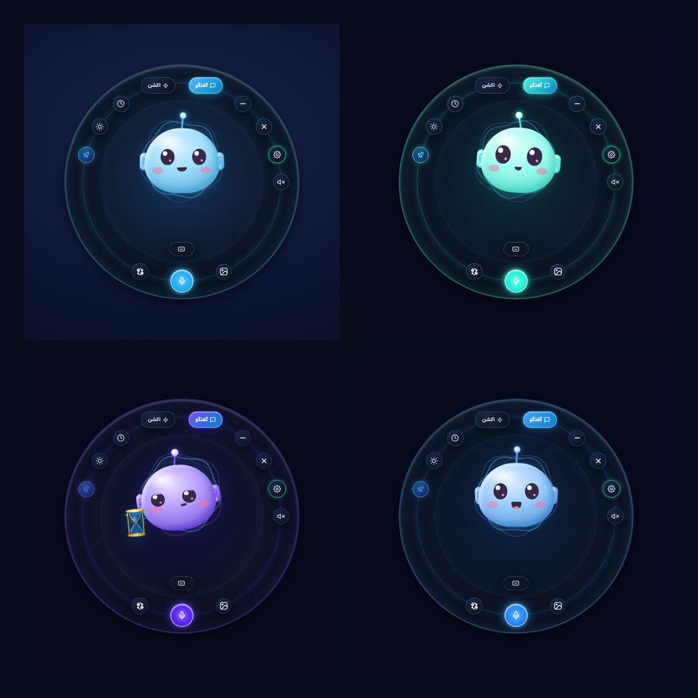
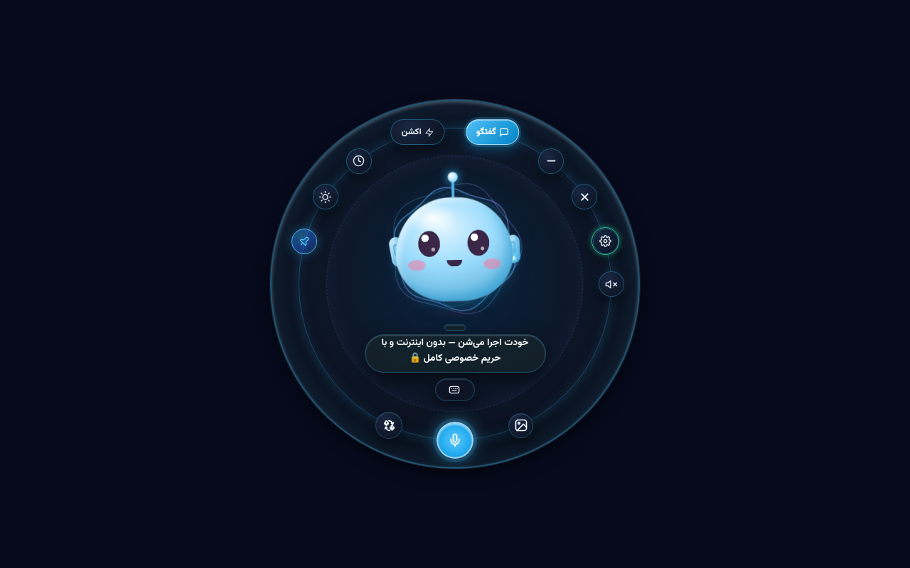
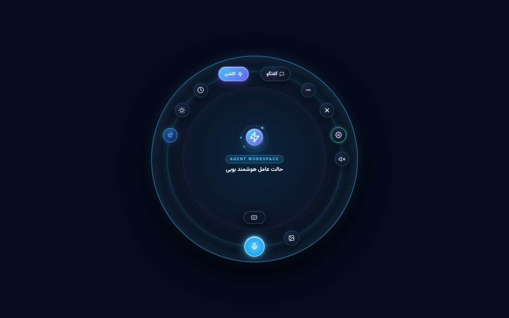
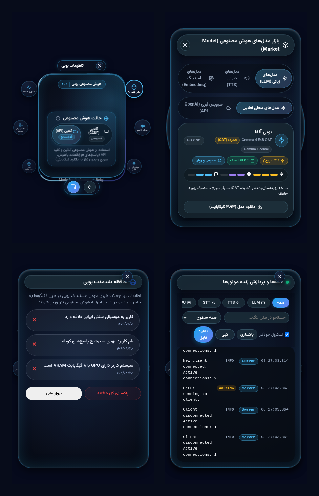
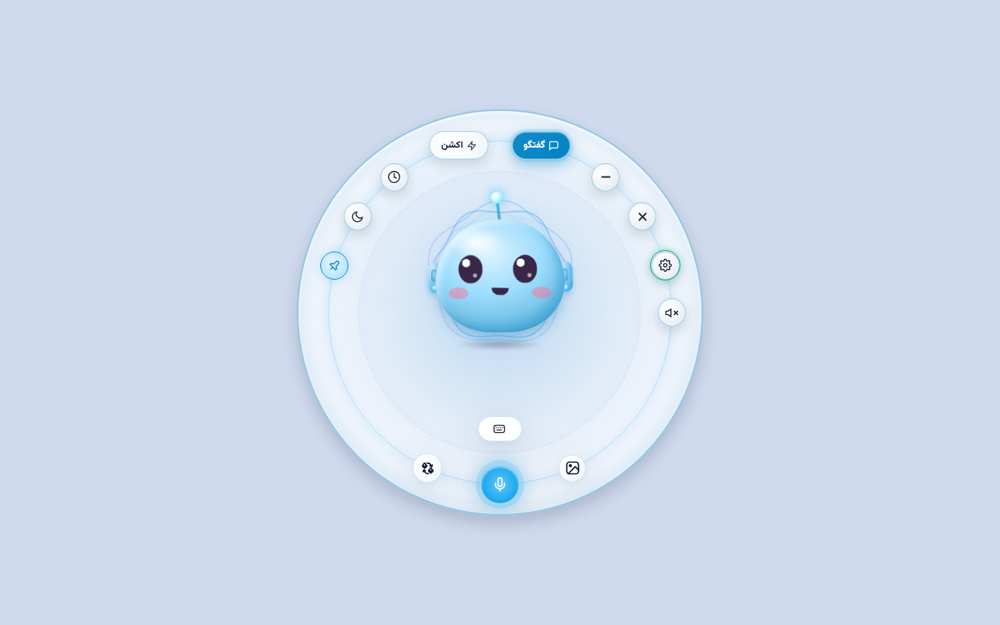

<div align="center">



# 🎙️ Bobi Voice Assistant (دستیار صوتی هوشمند بوبی)

[](https://github.com/mbeigi88/bobi_voice_agent-pc/releases)
[-0078D6?style=for-the-badge&logo=windows)](https://github.com/mbeigi88/bobi_voice_agent-pc/releases)
[](#-credits--creator-سازنده-و-اعتبارات)

> **Next-Generation Persian AI Desktop Companion & Voice Assistant**
> تجربه نسل جدید هوش مصنوعی صوتی و تعاملی فارسی در محیط دسکتاپ ویندوز، با معماری سبک، رابط شیشه‌ای مدرن (Liquid Glass) و استقلال کامل بدون نیاز به ابزارهای جانبی.

**English:** Bobi is a local-first, bilingual (Persian/English) desktop AI companion — voice chat, agentic desktop automation, vision, long-term memory and a living animated avatar, packaged as a zero-configuration Windows installer.

</div>

---

## 🇮🇷 درباره بوبی (خلاصه به فارسی)

**دستیار صوتی بوبی (Bobi)** یک همیار همه‌فن‌حریف و پیشرفته برای سیستم‌عامل ویندوز است که با تکیه بر فناوری‌های نوین پردازش زبان طبیعی و تولید صدا، تجربه گفت‌وگوی صوتی پیوسته و روان به زبان شیرین فارسی را بدون تأخیر محسوس به شما ارائه می‌دهد.

بوبی مجهز به موتورهای صوتی محلی و سبک **Pocket-TTS** و **Cilla-Lite** است که برای زبان فارسی بهینه‌سازی شده‌اند و از اجرای آفلاین مدل‌های زبانی محلی (**GGUF**) و ارتباط با برترین ارائه‌دهندگان هوش مصنوعی بین‌المللی پشتیبانی می‌کند. بوبی علاوه بر همراهی صوتی، از قابلیت اختصاصی **Action Mode** بهره می‌برد و می‌تواند مانند یک دستیار کامپیوتری واقعی کارهای دسکتاپ شما را مدیریت کند.

هر نسخه‌ی نصبی به‌صورت کاملاً خودکار و رسمی از طریق **GitHub Actions** بیلد و منتشر می‌شود؛ نسخه‌ی فعلی: **v2.6.3** با نصاب `Bobi_Setup_v2.6.3.exe`.

---

## 🎬 دموی زنده انیمیشن‌ها

آواتار بوبی یک موتور انیمیشن کامل دارد: ۲۸ حالت احساسی با رنگ، حرکت و افکت اختصاصی. دموی زیر تمام احساسات را به‌صورت زنده پخش می‌کند:

<div align="center">

</div>

---

## 🎭 آواتار زنده با ۲۸ احساس

ربات شیشه‌ای بوبی متناسب با لحن گفت‌وگو تغییر چهره می‌دهد؛ هر احساس رنگ حلقه، شکل دهان و چشم، انیمیشن بدن و افکت‌های شناور مخصوص خودش را دارد:

<div align="center">

</div>

| احساس | | احساس | | احساس | |
|:---:|:---:|:---:|:---:|:---:|:---:|
| آرام 🌊 | `idle` | گوش دادن 👂 | `listening` | فکر کردن 🤔 | `thinking` |
| صحبت کردن 🗣️ | `speaking` | شاد 😄 | `happy` | خندیدن 😂 | `laughing` |
| ناراحت 😢 | `sad` | تعجب 😮 | `surprised` | عصبانی 😠 | `angry` |
| عاشق ❤️ | `love` | خواب‌آلود 😴 | `sleepy` | گیج 🤯 | `confused` |
| هیجان‌زده 🤩 | `excited` | خجالتی 😊 | `shy` | ترسیده 😨 | `scared` |
| چشمک 😉 | `wink` | گریه 😭 | `cry` | مخالفت ✊ | `protest` |
| قهر 😤 | `sulk` | قهقهه 🤣 | `roar` | رقص 💃 | `dance` |
| سرگیجه 😵 | `dizzy` | شیطنت 😏 | `sly` | مغرور 😎 | `proud` |
| داغ شدن 🥵 | `hot` | خطا ⚠️ | `error` | تایید ✅ | `approve` |
| رد شدن ❌ | `deny` | | | | |

---

## 🤲 حالت اکشن در عمل (دموی تبلیغاتی)

ضبط زنده از رابط کاربری واقعی برنامه — چهار سناریوی کامل با تایم‌لاین واقعی ابزارها، دروازه تایید و کپشن توضیحی:

<div align="center">

</div>

---

## ✨ Key Features (ویژگی‌های کلیدی)

- 🗣️ **Ultra-Low Latency Persian Voice Chat (گفت‌وگوی پیوسته فارسی)**
  - مجهز به موتورهای صوتی پرسرعت محلی **Pocket-TTS** و **Cilla-Lite** سفارشی‌سازی‌شده برای ادای دقیق و شفاف کلمات فارسی.
  - موتورهای TTS چندگانه: Pocket-TTS، Cilla-Lite (۱۰۰M تک‌گامه بر CPU)، Piper، Kokoro، Supertonic، Edge و Mana — با تنظیم سرعت، زیر و بمی (Pitch) و پیش‌نمایش صدا.
  - تعامل صوتی لحظه‌ای و روان، بدون قطعی و با کمترین میزان Latency روی سخت‌افزارهای استاندارد.

- 🤖 **Local GGUF Models & Cloud AI APIs (پشتیبانی جامع از مدل‌ها)**
  - سازگاری کامل با مدل‌های کوانتایز شده محلی به فرمت **GGUF** (نظیر Llama 3، Qwen، Mistral و مدل‌های اختصاصی فارسی) از طریق موتور **llama.cpp** با شتاب‌دهی CUDA / Vulkan / CPU.
  - بهینه‌سازی‌های استنتاج: **Flash Attention** و کش ورودی-خروجی کوانتیزه‌شده **KV-Cache Q8** برای حداکثر سرعت با حداقل مصرف VRAM.
  - پشتیبانی یکپارچه از API سرویس‌های هوش مصنوعی ابری سازگار با **OpenAI** (OpenAI، Groq، Claude، Gemini و غیره) با تست اتصال و دریافت خودکار فهرست مدل‌ها.
  - مدل پیش‌فرض آماده‌ی کار: **«بوبی آلفا»** — Gemma 4 E4B کوانتیزه QAT (~۳.۹ گیگابایت) با انتخاب هوشمند بر اساس سخت‌افزار شما.

- 🤲 **حالت اکشن (Action Mode) — عامل هوشمند دسکتاپ**
  - توانایی تعامل مستقیم با سیستم‌عامل ویندوز: وب‌گردی هوشمند، جستجوی فایل‌ها، اجرای برنامه‌ها، خلاصه‌سازی اسناد و انجام دستورات کاربر به صورت خودکار.
  - **سناریوهای واقعی:** از خواندن مشخصات سخت‌افزار و ساخت فایل روی دسکتاپ تا تغییر تنظیمات ویندوز و استعلام قیمت از سرویس‌های آنلاین (نمونه: استعلام قیمت مک‌بوک از MCP دیجی‌کالا — دموی بالا).
  - **دروازه تایید کاربر (Approval Gate):** عملیات مخرب یا حساس (فایل/دستور/سیستم) پیش از اجرا از شما مجوز می‌گیرند و برای هر ابزار سیاست جداگانه قابل تعریف است.
  - پشتیبانی از پروتکل سرورهای افزونه و ابزارها (**Model Context Protocol — MCP**) با مدیریت، فعال/غیرفعال‌سازی و نوسازی سرورها از داخل رابط کاربری.

- 👁️ **Vision (تحلیل تصویر)**
  - ارسال تصویر از فایل یا گرفتن اسکرین‌شات و تحلیل چندوجهی با مدل‌های Vision — خلاصه‌سازی، توضیح و پاسخ به سوال درباره تصویر.

- 💾 **حافظه بلندمدت هیبریدی (Hybrid Memory)**
  - ترکیب جستجوی **برداری (Vector)** و **متنی (Lexical)** با مدل امبدینگ Nexus؛ بوبی نکات مهم مکالمات را به خاطر می‌سپارد و شما می‌توانید آن‌ها را مشاهده، ویرایش یا حذف کنید.

- 📦 **بازار مدل‌ها (Model Market)**
  - دانلود مستقیم مدل‌های LLM، TTS و Embedding از کاتالوگ داخلی با **دانلود چنداتصاله‌ی قابل ادامه (Resumable Multi-Connection)**، نوار پیشرفت لحظه‌ای، توقف/ادامه/حذف و مدیریت خودکار VRAM.
  - دانلود مدل Cilla-Lite از مخزن عمومی **بدون نیاز به توکن** Hugging Face (از نسخه v2.5.2).

- 🗂️ **نشست‌ها، تاریخچه و گزارش‌گیری**
  - مدیریت نشست‌های گفتگو با تاریخچه ماندگار، ردیابی **مصرف توکن** به‌تفکیک نشست، و **لاگ زنده** موتورهای LLM / TTS / STT با فیلتر و خروجی گرفتن.

- 🪟 **Liquid Glass & Minimalist UI (رابط کاربری مدرن شیشه‌ای)**
  - طراحی رابط کاربری چشم‌نواز با جلوه‌های بلور و شیشه‌ای (Fluent/Aero Glass)، انیمیشن‌های ارگانیک و طراحی مدرن و فشرده.
  - **تم تاریک و روشن** با یک کلیک، رندر مارک‌داون و فرمول‌های ریاضی (KaTeX) در پاسخ‌ها، کادر گفتگوی شناور و داک کنترل ارگانیک.
  - **Always-on-Top** و دسترسی فوری با کلیدهای میانبر سیستمی (Global Hotkeys) بدون اشغال فضای کاربری.

- ⚙️ **تنظیمات و تجربه شخصی‌سازی‌شده**
  - ناوبر دایره‌ای تنظیمات با بخش‌های صدا، میکروفون (+ **میک‌بوست** و تست میکروفون)، هوش مصنوعی، MCP و ابزارها، عیب‌یابی سیستم و UI.
  - معمار **Onboarding** برای راه‌اندازی اولیه و انتخاب مدل متناسب با سخت‌افزار.

- 📦 **Zero-Configuration Standalone Package (نصب آسان و مستقل)**
  - بسته نصبی کاملاً یکپارچه، بدون نیاز به نصب اولیه پایتون، محیط‌های مجازی، کامپایلرهای C++ یا ابزارهای جانبی. همه‌چیز داخل نصاب گنجانده شده است!

---

## 🖼️ گالری رابط کاربری

<div align="center">

<p><sub>چهار حالت اصلی آواتار: آرام · گوش دادن · فکر کردن · صحبت کردن</sub></p>
</div>

<div align="center">

<p><sub>گفت‌وگوی زنده با کپسول پاسخ و رندر مارک‌داون</sub></p>
</div>

<div align="center">

<p><sub>حالت عامل هوشمند (Action Mode — Agent Workspace)</sub></p>
</div>

<div align="center">

<p><sub>تنظیمات (ناوبر دایره‌ای) · بازار مدل‌ها · حافظه بلندمدت · لاگ زنده موتورها</sub></p>
</div>

<div align="center">

<p><sub>رابط کاربری در تم روشن</sub></p>
</div>

---

## 📥 Download & Installation (دانلود و نصب)

همواره می‌توانید آخرین نسخه پایدار بسته نصبی ویندوز را مستقیماً از بخش Releases دانلود فرمایید:

[-brightgreen?style=for-the-badge&logo=windows)](https://github.com/mbeigi88/bobi_voice_agent-pc/releases/latest)

> 🔗 **لینک مستقیم Releases:**
> [https://github.com/mbeigi88/bobi_voice_agent-pc/releases](https://github.com/mbeigi88/bobi_voice_agent-pc/releases)

### مراحل نصب (Installation Steps):
1. فایل نصاب `Bobi_Setup_v*.exe` را از لینک بالا دانلود کنید (نسخه فعلی: `Bobi_Setup_v2.6.3.exe` با حجم حدود ۲۱۵ مگابایت).
2. روی فایل دوبار کلیک کرده و مراحل نصب را در مسیر پیش‌فرض یا دلخواه پیش ببرید.
3. پس از اتمام نصب، شورتکات **Bobi** بر روی دسکتاپ و منوی استارت در دسترس خواهد بود.
4. با فشردن میانبر یا باز کردن برنامه، بوبی آماده همراهی شماست!

> 💡 **دو نسخه نصاب:** `Bobi_Setup_v2.6.3.exe` (نسخه سبک بهینه) و `Bobi_Setup_Full_v2.6.3.exe` (همراه با مدل محلی). در هر دو حالت می‌توانید مدل‌های دیگر را از **بازار مدل‌ها** داخل برنامه دانلود کنید.

---

## 💻 System Requirements (حداقل سیستم مورد نیاز)

| مشخصه | حداقل سیستم (Minimum) | سیستم پیشنهادی (Recommended) |
| :--- | :--- | :--- |
| **سیستم‌عامل (OS)** | Windows 10 (64-bit) Build 19041+ | Windows 11 (64-bit) |
| **پردازنده (CPU)** | Intel Core i3 / AMD Ryzen 3 (Quad Core) | Intel Core i5 / AMD Ryzen 5 یا بالاتر |
| **حافظه رم (RAM)** | 8 گیگابایت | 16 گیگابایت یا بیشتر |
| **فضای دیسک (Disk)** | 4 گیگابایت فضای خالی (SSD پیشنهادی) | 10+ گیگابایت برای ذخیره مدل‌های GGUF |
| **کارت گرافیک (GPU)** | پردازنده گرافیکی مجتمع (DirectX 12 / Vulkan) | کارت گرافیک مستقل NVIDIA یا کارت‌های با پشتیبانی Vulkan |
| **تجهیزات ورودی** | میکروفون استاندارد و بلندگو / هدفون | میکروفون با قابلیت کاهش نویز (Noise Canceling) |

---

## 🏗️ معماری و عملکرد (Architecture & Performance)

بوبی با معماری **FastAPI + WebSocket** در بک‌اند، شِل نیتیو ویندوز (WebView2) و فرانت‌اند **Vanilla ES** ماژولار ساخته شده — بدون هیچ فریم‌ورک سنگین فرانت‌اند.

### نکات برجسته مهندسی

- **شِل واکنش‌گرای پرتره‌محور:** چیدمان عمودی RTL با Flexbox، هماهنگ با پریست‌های رسمی پنجره — بدون هیچ هک `transform: scale()` یا `zoom`.

- **شبکه‌سازی یکپارچه و ذخیره‌سازی اتمیک:** دانلودر استریمینگ مشترک با فال‌بک SSL و خواندن تنظیمات با کش `mtime` (تا **۶۵.۹ برابر** سریع‌تر در خواندن‌های متوالی) و نوشتن اتمیک (temp-file + `os.replace`) برای تنظیمات، حافظه و نشست‌ها.
- **گفتار رویدادمحور و پارسر استریمینگ:** صف گفتار `ActionSpeechQueue` با `threading.Condition` به‌جای Polling (**صفر** نخ Polling در حالت سکوت) و بچ‌کردن دلتاهای استدلال در WebSocket (**‑۹۷٪** پیام‌های broadcast حین استدلال).
- **پاک‌سازی گفتار (TTS Sanitization):** بلوک‌های داخلی «تفکر»، فراخوانی ابزارها و متادیتای ACTION هرگز به موتور صوتی ارسال نمی‌شوند.

### ساختار پروژه (Project Structure)

```text
bobi/
├── assistant.py          # هسته هماهنگ‌کننده حلقه گفتگو و صوت
├── config.py             # مسیرها، پریست‌های پنجره، تنظیمات اتمیک با کش mtime
├── diagnostics.py        # عیب‌یابی سیستم و رانتایم با پوشش اسرار
├── gpu.py                # پروب VRAM/RAM و برنامه‌ریز محدود GGUF
├── http_utils.py         # دانلودر chunked تاب‌آور + فال‌بک SSL
├── llama_downloader.py   # یافتن و استخراج llama-server از ریلیزهای GitHub
├── llm.py                # چرخه عمر llama-server و کلاینت سازگار OpenAI
├── logger.py             # بافر لاگ محدود با پوشش خودکار اسرار
├── memory.py             # حافظه بلندمدت هیبریدی (برداری + متنی) با نوشتن اتمیک
├── model_catalog.py      # کاتالوگ یکپارچه GGUF، TTS و امبدینگ Nexus
├── model_downloader.py   # دانلودر چندفایلی قابل ادامه برای مدل‌ها
├── model_manager.py      # وضعیت دانلود، بررسی یکپارچگی و جابه‌جایی مدل
├── server.py             # سرور FastAPI (REST + WebSocket)
├── session_manager.py    # تاریخچه ماندگار نشست‌های گفتگو با نوشتن اتمیک
├── speech_text.py        # پاک‌ساز متن فارسی/انگلیسی برای خروجی تمیز TTS
├── stt.py                # جریان میکروفون و موتور تبدیل گفتار به متن
├── token_tracker.py      # ردیاب محدود مصرف توکن هر نشست
├── tts.py                # موتورهای چندگانه TTS (Mana، Piper، Supertonic، Kokoro، Edge)
├── vision.py             # ثبت وبکم/تصویر و فشرده‌سازی چندوجهی
└── action/               # رانتایم محدود اجرای ابزار عامل هوشمند (Orchestrator، MCP، Tools)
web/
├── index.html            # پوسته RTL فارسی رابط کاربری و مودال‌ها
├── css/                  # استایل‌شیت‌های ماژولار (۹ فایل)
└── js/                   # کنترلرهای فرانت‌اند Vanilla ES (۱۵ فایل)
```

---

## 🔒 Security & Privacy (حریم خصوصی و امنیت)

- **ارتباطات محلی:** داده‌های صوتی پردازش‌شده با موتورهای محلی به هیچ سرور خارجی ارسال نمی‌شوند.
- **CORS فقط-لوکال‌هاست:** هیچ وایلدکارد `*` با اعتبارنامه وجود ندارد.
- **مقابله با SSRF:** مسدودسازی schemeهای ناامن و IPهای خصوصی/Loopback در `fetch_url` و ریدایرکت‌ها.
- **پوشش اسرار:** مخفی‌سازی خودکار کلیدهای API و توکن‌ها در لاگ‌ها و عیب‌یابی.
- **شفافیت در عملکرد اکشن:** تمامی عملیات تعاملی بر روی سیستم با تایید کاربر یا گزارش مشخص در لاگ‌ها انجام می‌شوند.
- **تک‌نمونه‌ای (Single Instance):** قفل Mutex همگام بین Launcher و سرویس بک‌اند.
- **بسته رسمی و دست‌نخورده:** فایل‌های نصبی منتشر شده در این ریپوزیتوری مستقیماً از طریق GitHub Actions اتوماتیک و رسمی بیلد شده‌اند.

---

## 👨‍💻 Credits & Creator (سازنده و اعتبارات)

* **Developed by:** **Mohammad Beigi** (`mbeigi88`)
* **Project:** Bobi Voice Assistant — Windows PC Edition
* **📧 Contact / تماس:** [robamad1396@gmail.com](mailto:robamad1396@gmail.com)

برای ثبت گزارش باگ‌ها، پیشنهادات و بازخوردها می‌توانید از بخش [GitHub Issues](https://github.com/mbeigi88/bobi_voice_agent-pc/issues) این ریپوزیتوری استفاده نمایید.
